<div align="center">

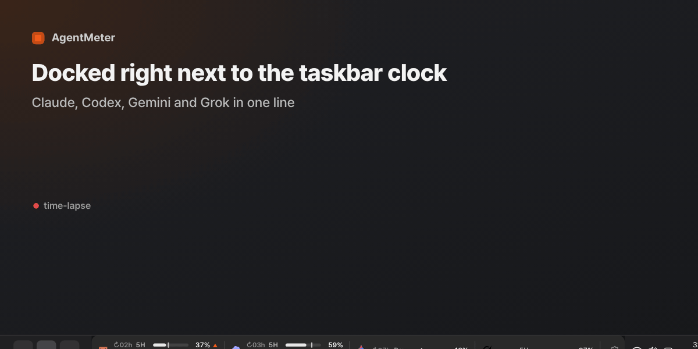

# AgentMeter

**Claude Code · Codex · Gemini CLI · Antigravity · Grok** の使用上限と使用量を、<br>
Windows のタスクバー、Mac のメニューバー、デスクトップでそのまま確認できるデスクトップウィジェット

[](https://github.com/cheapbutsimilar/Agent-Meter/releases/latest)


[](LICENSE)

[English](README.md) | [한국어](README.ko.md) | **日本語** | [简体中文](README.zh-CN.md)

[**ダウンロード**](https://github.com/cheapbutsimilar/Agent-Meter/releases/latest) &nbsp;·&nbsp;
[機能](#機能) &nbsp;·&nbsp;
[ウィジェット](#ウィジェット) &nbsp;·&nbsp;
[ダッシュボード](#ダッシュボード) &nbsp;·&nbsp;
[インストール](#インストール) &nbsp;·&nbsp;
[仕組み](#仕組み) &nbsp;·&nbsp;
[プライバシー](#プライバシー) &nbsp;·&nbsp;
[FAQ](#よくある質問) &nbsp;·&nbsp;
[開発](#開発)

</div>

> **言語について：** 現在、アプリの UI は英語と韓国語に対応しています。日本語 UI は今後追加する予定です。

複数の AI コーディングエージェントを併用していると、**どの上限が先に尽きるのか**、**リセットまで持つのか**が分かりにくくなります。
AgentMeter は各サービスの公式な上限パーセンテージと、お使いのマシン上の使用ログを読み取り、タスクバーの 1 行、またはデスクトップの小さなカードとして表示します。
今のペースでいつ上限に達するかを計算し、本当に急ぐときだけ通知します。また、同じ使用量を API 料金で使った場合のコストも表示します。

- **100% ローカル、テレメトリなし。** サーバーもアカウントも分析もありません。使用状況がコンピューターの外に出ることはありません。
- **検証可能なソースビルド。** すべてのリリースは、このリポジトリから公開の GitHub Actions ワークフローでビルドされています。[自分でビルド](#ソースからビルド)することもできます。
- **小さくて軽い。** Rust + Tauri 製の 2.3 MB のインストーラーで、ログは新しい行だけを読み取ります。

## 機能

| | |
| --- | --- |
| **公式の上限 %** | Claude の 5 時間・週間・モデル別上限（Claude Fable など）、Codex の 5 時間・週間（アカウント全体）、Gemini CLI の日次クォータ、Antigravity CLI の 5 時間・週間上限（Windows）を各サービスから直接取得します。Gemini CLI と Antigravity は別のエージェントなので、両方を並べて確認できます。エージェントの作業中は 1 分以内に上限を再確認します。 |
| **使い切り予測** | 最近のペースから上限に達する時刻を計算し、リセットより前に尽きそうなときは `▲ runs out in 40m at this pace` と表示します。 |
| **ペースマーク** | 各バーのマークが、上限期間のどれだけが経過したかを示します。バーがマークより先にあれば、普段より速いペースです。 |
| **API 換算コスト** | 公開 API 価格で今日・7 日・30 日のコストを見積もります（例：`$44.48 today · 7d $272 · 30d $1,016`）。表示は USD で、KRW（₩）または両方も選べます。 |
| **分析** | 日別のトークン・コストのグラフ（14 日または 30 日）、時間帯別ヒートマップ、プロジェクト別・モデル別の使用量、CSV エクスポート。 |
| **控えめな通知** | しきい値（既定は 80% と 95%）、リセット時、そして 1 時間以内に上限が尽きそうなときだけ通知します。各通知は再起動をまたいでも期間ごとに 1 回だけです。 |
| **ワンクリック接続** | CLI がない、またはログインしていない場合、ボタン 1 つでターミナルが開き、CLI のインストールとログインを行います。完了すると AgentMeter が自動で認識します。 |
| **アップデート通知** | 新しいバージョンが出ると変更内容が表示され、*今すぐ更新* か *後で* を選べます。過去のパッチノートも設定からいつでも確認できます。 |
| **英語と韓国語** | システム言語に従います。設定 → General → Language からいつでも切り替えられます。日本語 UI は今後追加予定です。 |

## ウィジェット

1 つのウィジェットに 2 つのレイアウト。`PageUp` で切り替えます。

- **カード（既定）**：各エージェントの上限バー、残量、リセットまでの時間、使い切り予測、今日のトークンとコストを表示するフローティングカード。どのモニターのどこにでも置けます。
- **ストリップ**：`↻02h 5H ▬▬▬ 37%` のようにエージェントごとに 1 行。時計の横で**タスクバーにドッキング**でき、上に引き出すとデスクトップに浮かべられ、タスクバーの近くに落とすと再びドッキングします。

| 操作 | 方法 |
| --- | --- |
| ストリップ ↔ カードの切り替え | `PageUp`、または右クリックメニュー |
| ウィジェットの表示 / 非表示 | `Shift+PageUp` |
| ダッシュボードを開く | ウィジェットをダブルクリック、またはトレイアイコンをクリック（Mac：メニューバーのアイコン → Open dashboard） |
| ウィジェットの設定 | ウィジェットの ⚙ ボタン |
| 位置の固定 · 常に手前 · 残量表示 | 右クリックメニュー |

動画やゲームなどの全画面アプリの使用中は、ウィジェットは背面に下がります。

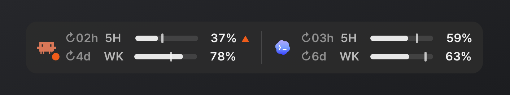

<p align="center">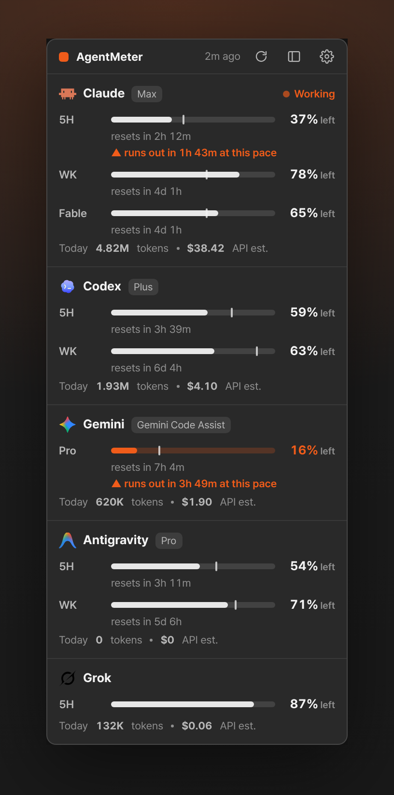</p>

### 外観

ダッシュボード → **Appearance** でテーマを選べます。すべての値は安全な範囲に収まるため、レイアウトが崩れることはありません。

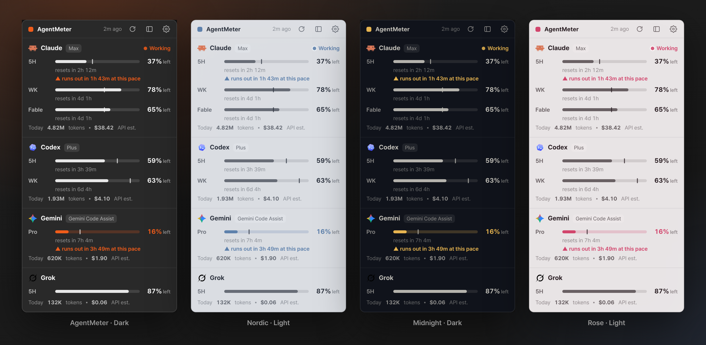

- **モード**：システム、ライト、ダーク（システムは Windows / macOS の設定に従います）
- **テーマ**：AgentMeter、Midnight、Nordic、Forest、Graphite、Rose（それぞれライトとダーク）
- **色**：アクセント・背景・文字の色を自由に設定。文字のコントラストが 4.5:1 を下回ると警告します
- **サイズ**：フォント、ダッシュボードの倍率（90–125%）、ウィジェットの不透明度・倍率・バーの長さ・カード幅・角の丸み

## ダッシュボード

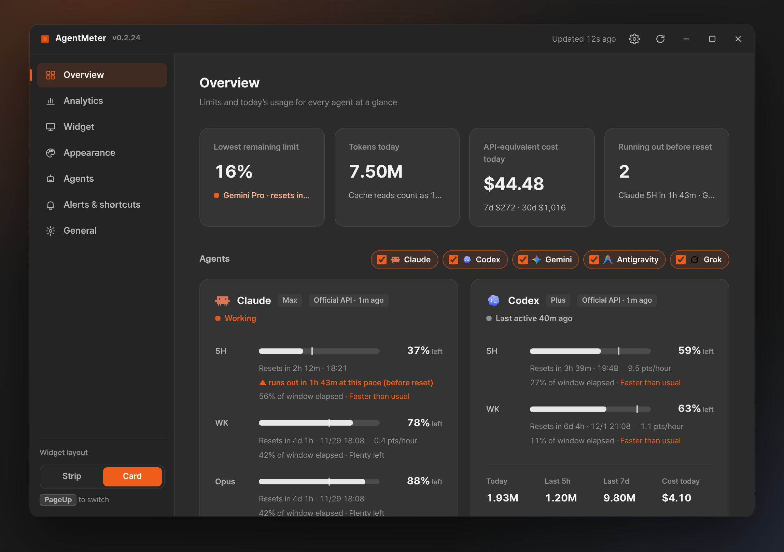

<table>
<tr>
<td width="50%">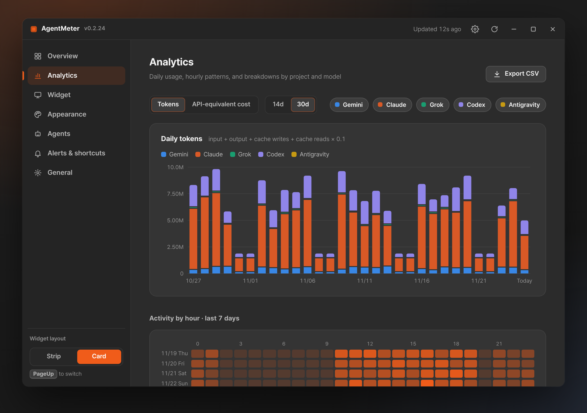<p align="center"><b>分析</b> · 日別グラフ、時間帯ヒートマップ、プロジェクト別・モデル別の使用量</p></td>
<td width="50%">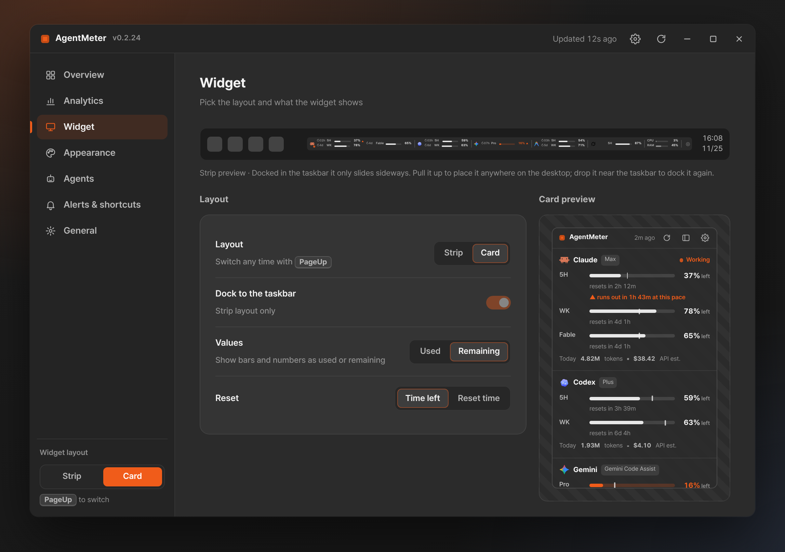<p align="center"><b>ウィジェット</b> · ライブプレビューを見ながら項目をオン・オフ</p></td>
</tr>
<tr>
<td>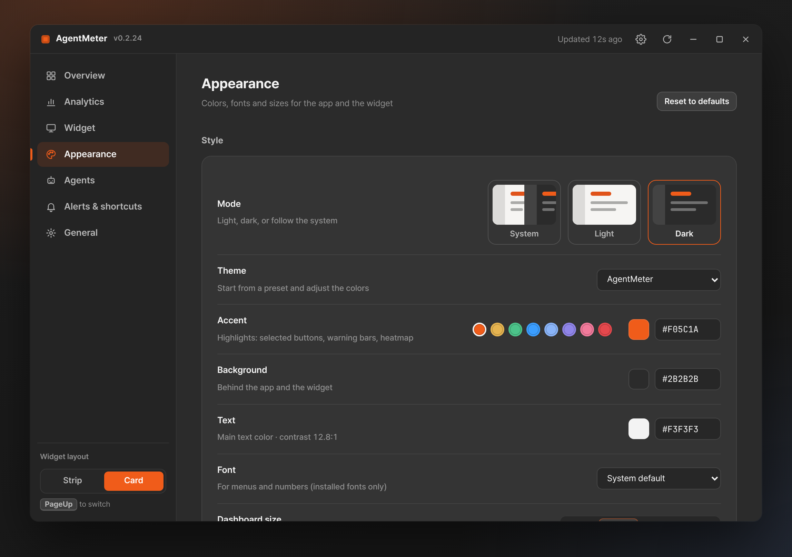<p align="center"><b>外観</b> · テーマ、色、フォント、サイズ</p></td>
<td>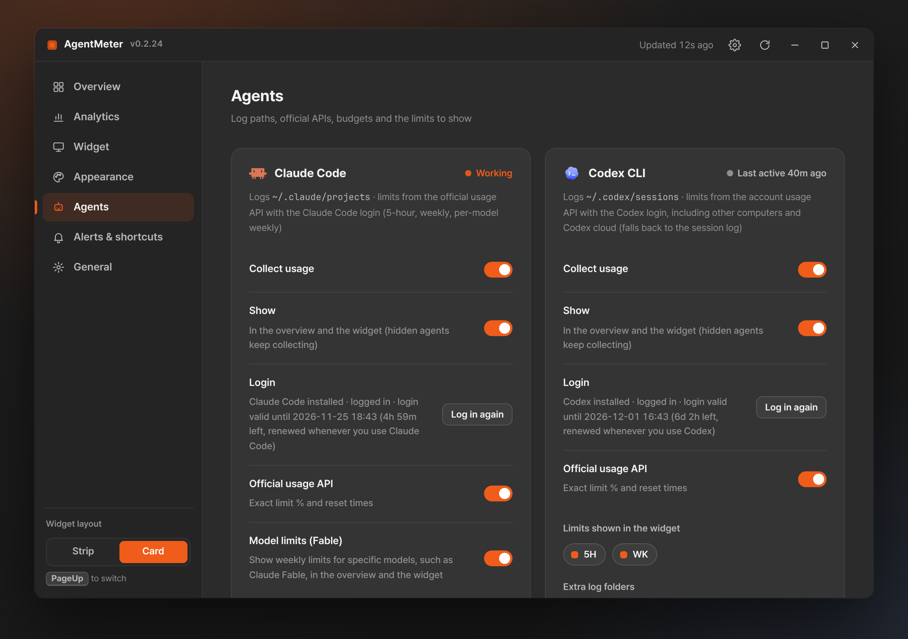<p align="center"><b>エージェント</b> · ログイン、公式 API、表示する上限</p></td>
</tr>
<tr>
<td>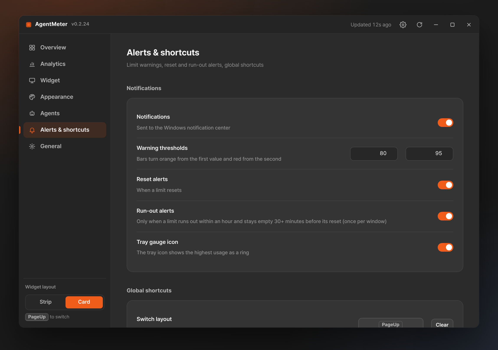<p align="center"><b>通知とショートカット</b> · しきい値、リセット通知、使い切り通知</p></td>
<td>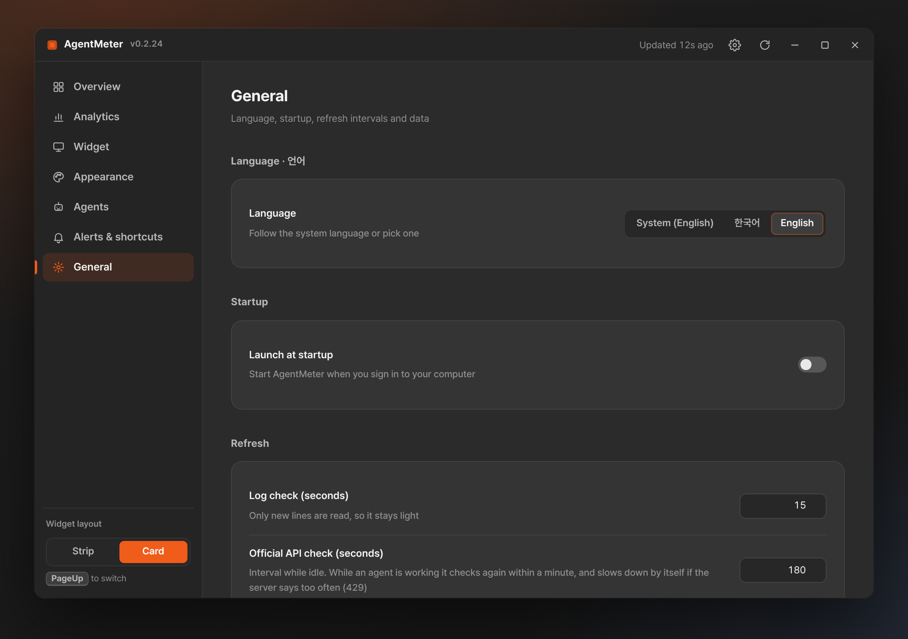<p align="center"><b>一般</b> · 言語、起動、アップデート、通貨</p></td>
</tr>
</table>

## インストール

### Windows

1. [**最新リリース**](https://github.com/cheapbutsimilar/Agent-Meter/releases/latest)から `AgentMeter_<version>_x64-setup.exe` をダウンロードして実行します。
2. **「Windows によって PC が保護されました」** と表示されたら、**詳細情報 → 実行** をクリックしてください。個人のオープンソースプロジェクトのため、インストーラーにはコード署名がありません。すべてのリリースはこのリポジトリから[公開ワークフロー](.github/workflows/release.yml)でビルドされ、アップデートはインストール前に署名鍵で検証されます。
3. ユーザー単位でインストールされるため、管理者権限は不要です。初回起動時にダッシュボードが開き、右下にウィジェットが、トレイにゲージアイコンが表示されます。
4. 以前に Claude Code、Codex、Gemini CLI、Antigravity CLI にログインしていれば、上限がすぐに表示されます。そうでない場合は、ダッシュボードの概要またはエージェントで **Connect** をクリックしてください。CLI がなければインストールし、ログインを開きます。

### macOS

1. [**最新リリース**](https://github.com/cheapbutsimilar/Agent-Meter/releases/latest)から `AgentMeter_<version>_universal.dmg` をダウンロードします。1 つのファイルで Apple Silicon と Intel の Mac の両方でネイティブに動作します（macOS 11 Big Sur 以降）。
2. `.dmg` を開き、**AgentMeter** を **アプリケーション** フォルダーにドラッグします。
3. Apple の公証（notarization）を受けていない個人のオープンソースプロジェクトのため、初回起動時に **Gatekeeper** が「"AgentMeter" は開けません」「Apple は検証できませんでした」と表示してブロックします。次のどちらかの方法で一度だけ許可してください。
   - **システム設定 → プライバシーとセキュリティ** を下にスクロールし、AgentMeter の横の **このまま開く** をクリックして確認します。（macOS 14 以前では、アプリケーションフォルダーでアプリを Control キーを押しながらクリック → **開く** → **開く** でも可能です。）
   - またはターミナルで：`xattr -dr com.apple.quarantine /Applications/AgentMeter.app`
4. AgentMeter は **メニューバー** に常駐します（Dock アイコンはありません）。ゲージアイコンをクリックするとメニューが開き、ウィジェットはストリップ・カードのどちらもデスクトップに浮かびます。`PageUp`（MacBook のキーボードでは `fn` + `↑`）で切り替え、**常に手前** はウィジェットの右クリックメニューにあります。Mac にはタスクバーがないため、ストリップも常にフローティング表示です。

Mac では Claude Code のログイン情報を **キーチェーン**（`Claude Code-credentials`）から読み取るため、最初にアクセスを許可するか一度だけ尋ねられることがあります。**常に許可** を選んでください。Antigravity CLI の取得は現在 Windows のみです。

新しいバージョンが出ると、**変更内容**と *今すぐ更新 / 後で* を示すウィンドウが表示されます。AgentMeter は起動 20 秒後と 3 時間ごとに確認します。ダッシュボード → General → Updates から、今すぐ確認、パッチノートの閲覧、サイレントインストールへの切り替えもできます。全履歴は [CHANGELOG.md](CHANGELOG.md)（韓国語）にあります。

> Windows 10 / 11（x64）と macOS 11 以降（Apple Silicon・Intel）向けに配布しています。Windows に必要な WebView2 ランタイムは Windows に同梱されています。
> Linux は[ソースからビルド](#ソースからビルド)でき、タスクバーへのドッキングは Windows 専用です。

## 仕組み

AgentMeter のサーバーはありません。すべて**お使いのマシン上のログファイル**と、**各 CLI がすでに保存しているログイン情報**から読み取ります。

| エージェント | トークンとコスト（ローカルログ） | 上限 %（公式 API） | ログイン |
| --- | --- | --- | --- |
| **Claude Code** | `~/.claude/projects/**/*.jsonl` | `api.anthropic.com/api/oauth/usage`：5 時間・週間・モデル別上限（例：Fable）。プランは `/api/oauth/profile` から | `~/.claude/.credentials.json` · macOS キーチェーン |
| **Codex CLI** | `~/.codex/sessions/**/rollout-*.jsonl` | `chatgpt.com/backend-api/wham/usage`：アカウント全体の 5 時間・週間（他のコンピューターや Codex cloud を含む） | `~/.codex/auth.json` |
| **Gemini CLI** | `~/.gemini/tmp/*/chats/session-*.jsonl` | Code Assist `retrieveUserQuota`：モデルごとの日次クォータ | `~/.gemini/oauth_creds.json` |
| **Antigravity CLI**（Windows） | なし（トークンログなし） | 公式 `agy.exe` のステータス行から 5 時間・週間上限をバックグラウンドで読み取り（[詳細](docs/antigravity-native.md)） | 公式 CLI が管理し、AgentMeter は読み取りません |
| **Grok** | `~/.grok/**/*.jsonl` | 公式 API なし：トークン予算からの推定、または[カスタムコマンド](#カスタムコマンド) | |

- 読み取るのは**新しい行**だけです。再開されたセッション（以前のメッセージをコピーするもの）や重複イベントは除外されます。
- トークン数はキャッシュ読み取りを 10% として計算します（入力 + 出力 + キャッシュ書き込み + キャッシュ読み取り × 0.1）。
- プロジェクトはログに記録された作業フォルダーごとにまとめられます。
- `CLAUDE_CONFIG_DIR` と `CODEX_HOME` に対応しています。WSL で動くエージェントは、ダッシュボード → Agents → **Extra log folders** に `\\wsl.localhost\Ubuntu\home\<me>\.claude` のようなパスを追加してください。
- **Antigravity CLI** は Gemini CLI とは別のエージェントです。AgentMeter は `agy.exe` を自動で探します（`where agy`、次に `%LOCALAPPDATA%\agy\bin` などの既定のインストール先）。インストールされていなければ、ダッシュボード → Agents → Antigravity CLI の **Connect** が公式インストーラーを実行し、初回ログインを開きます。別の場所にある場合は **Browse…** で選んでください。AgentMeter は有効な Google LLC の署名を持つ `agy.exe` だけを、すべてのツールを拒否しプロンプトを送らない隔離された一時プロファイルで実行し、クォータの数値とプランだけを保持します。確認は最大 3 分ごとで、15 分より古い値は非表示にします。Antigravity はトークンログを書かないため、上限はありますがトークン数やコストはありません。詳しくは [docs/antigravity-native.md](docs/antigravity-native.md) をご覧ください。
- 使用量 API は非公開の内部エンドポイントのため、変更される可能性があります。失敗してもログベースの集計は動き続け、サーバーが *too many requests*（429）を返したときは間隔を空けます。

### プライバシー

- **テレメトリ、分析、アカウントは一切ありません。** 使用履歴はお使いのコンピューターにのみ残ります。
- ログイントークンは上記の公式エンドポイントにのみ送信されます。Antigravity のログインは公式 CLI が自身で管理し、AgentMeter はその認証情報を読みません。Claude Code のトークンが期限切れになると、AgentMeter は Claude Code と同じ方法で更新し、同じファイルに保存し直します。これは、Claude デスクトップアプリ内の Claude Code セッションがそのファイルを更新しないためです。他の CLI のトークンは読み取り専用です。
- ネットワーク通信は、表のエンドポイント、Claude のログイン更新（`platform.claude.com`）、KRW 表示用の為替レート（`open.er-api.com`）、アップデート確認（GitHub Releases）のみです。

### カスタムコマンド

任意のエージェントにコマンドを指定すると、その JSON 出力で上限ゲージを表示できます。公式の上限を知っている別のツールがある場合に便利です。

```json
{ "plan": "SuperGrok", "windows": [ { "label": "5H", "usedPercent": 42, "resetsAt": "2026-11-17T12:00:00Z" } ] }
```

## よくある質問

<details>
<summary><b>コストが請求額と違うのはなぜですか？</b></summary>

コストは**同じ使用量を公開 API 価格で使った場合の金額**です。サブスクリプション料金（Pro、Max など）や実際の請求額ではありません。API と比べてサブスクリプションでどれだけ節約できているかの目安にしてください。公開価格のないモデルは含まれません。
</details>

<details>
<summary><b>他のコンピューターでの使用量も含まれますか？</b></summary>

**上限パーセンテージ**は含まれます。公式 API から取得するため、アカウント全体（Claude、Codex、Gemini）が対象です。**トークンとコスト**はこのコンピューターのログだけを集計します。
</details>

<details>
<summary><b>プランを変更したのに古いプランが表示されます。</b></summary>

プランは 30 分ごとにアカウントから読み直します。少し待つか、CLI にもう一度ログインするとすぐに更新されます。
</details>

<details>
<summary><b>「Fable」とは何ですか？表示されないのはなぜですか？</b></summary>

Fable は、全体の週間上限とは別に独自の週間上限を持つ Claude のモデルです。AgentMeter は Claude の使用量 API が報告する限り、このようなモデル別上限を表示します。ダッシュボード → Agents → Claude で **Model limits (Fable)** がオンになっているか確認してください。
</details>

<details>
<summary><b>ウィジェットが消えました。</b></summary>

`Shift+PageUp` を押すか、トレイメニューからウィジェットをオンに戻してください。おかしな位置にある場合は、ダッシュボード → Widget → **Reset position** を使ってください。
</details>

<details>
<summary><b>他のアプリで PageUp が効かなくなりました。</b></summary>

グローバルショートカットは他のアプリからキーを奪います。ダッシュボード → Alerts & shortcuts で `Ctrl+PageUp` のような組み合わせに変えるか、オフにしてください。
</details>

<details>
<summary><b>通知が多すぎます。</b></summary>

ダッシュボード → Alerts & shortcuts で、通知の種類ごと、またはすべてをオフにできます。使い切り通知は、上限が 1 時間以内に尽き、リセットまで 30 分以上空のままになる場合にだけ、期間ごとに 1 回届きます。
</details>

## 開発

Rust + [Tauri 2](https://tauri.app) のアプリです。UI はビルド工程のない素の HTML、CSS、JS です。

| 目的 | Windows | コマンド |
| --- | --- | --- |
| **ブラウザープレビュー**：デモデータでウィジェットとダッシュボードを表示（アプリのビルド不要） | `preview.bat` | `cargo run -p agentmeter-devserver` |
| 自分の使用量で**実際のアプリを実行** | `dev.bat` | `cargo tauri dev` |
| **リリースビルド**：`agentmeter.exe` + インストーラー | `build.bat` | `cargo tauri build` |
| テスト | | `cargo test --workspace` |
| README 画像の再生成（[Playwright](https://playwright.dev)。Pretendard フォント推奨） | | `npm run screenshots` |

ブラウザープレビュー（`http://localhost:1420`）は `ui/` 以下のファイルを保存すると再読み込みされます。ページの URL に `?lang=en` または `?lang=ko` を付けると言語を選べます。開発版アプリは Rust のコードが変わると再ビルドして再起動します。

### ソースからビルド

[Git](https://git-scm.com) と [Rust](https://rustup.rs)（stable）が必要です。Linux では `libwebkit2gtk-4.1-dev libayatana-appindicator3-dev librsvg2-dev libxdo-dev` もインストールしてください。

```bash
git clone -b main https://github.com/cheapbutsimilar/Agent-Meter
```

```bash
cd Agent-Meter && cargo run --release -p agentmeter
```

インストーラーが必要な場合は、`cargo install tauri-cli --version "^2" --locked` を実行してから、リポジトリのフォルダーで `cargo tauri build` を実行します。

<details>
<summary><b>プロジェクト構成</b></summary>

```
crates/core/       コレクターとロジック（OS 依存なし、ユニットテスト付き）
crates/antigravity/  Windows ネイティブの Antigravity クォータ取得（ConPTY、署名確認、隔離プロファイル）
  usage/           Claude · Codex · Gemini · Antigravity · Grok のコレクター、予測、使用量台帳
  pricing.rs       モデルごとの API 価格      settings.rs  設定スキーマ、検証、移行
src-tauri/         ウィンドウ、マルチモニター、タスクバードッキング、ショートカット、トレイゲージ、通知、アップデート
ui/widget/         ウィジェットウィンドウ
ui/dashboard/      ダッシュボード
ui/update/         「新しいバージョン」ウィンドウ
ui/shared/         i18n.js（韓国語 / 英語）、tokens.css、theme.js、render.js（ウィジェット描画）、util.js、logos.js
crates/devserver/  ブラウザープレビューサーバー
scripts/           mock-api.js（デモデータ）、preview.js（README 画像）、release-notes.js、make-icons.py
docs/screenshots/  README 画像。demo-gif.js（デモ GIF）と strip-duo.js が実際のウィジェット UI から描画します（録画ではなく再現）
```

同じデザインとシェルで別のアプリを作る方法は [docs/HANDOFF.md](docs/HANDOFF.md)、リリースとアップデート署名の設定は [docs/RELEASING.md](docs/RELEASING.md) をご覧ください。
</details>

## ロードマップ

- macOS での Antigravity CLI 上限の取得（予定）
- 日本語・中国語 UI（予定）

## 注意事項

- **コストは公開 API 価格での見積もり**です。サブスクリプション料金や請求額ではありません。
- Claude、Codex（OpenAI）、Gemini と Antigravity（Google）、Grok（xAI）の名称とロゴは各所有者の商標です。AgentMeter は独立したプロジェクトであり、いずれとも提携していません。ロゴの SVG は [@lobehub/icons](https://github.com/lobehub/lobe-icons)（MIT）のものです。
- デザイン：ベース `#2B2B2B`、キーカラー `#F05C1A`。バーは通常は明るいグレー、1 つ目のしきい値からオレンジ、2 つ目から赤になります。色にはアイコンも添えるため、状態を色だけで判断する必要はありません。

<div align="center"><sub><a href="LICENSE">MIT License</a></sub></div>
