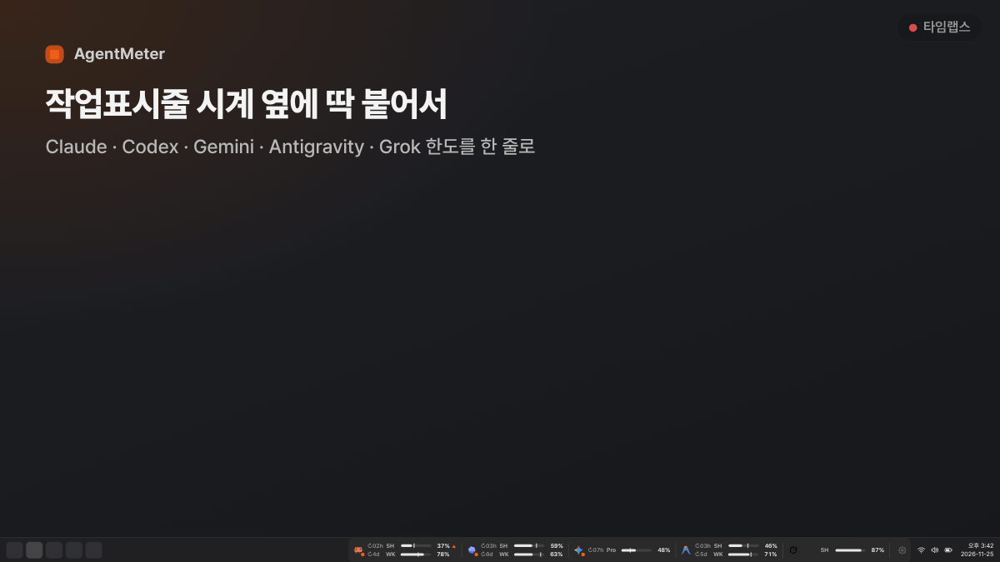
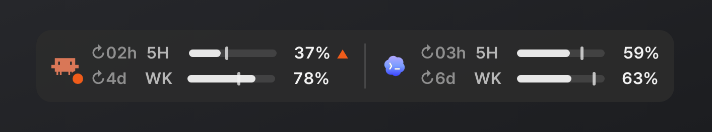
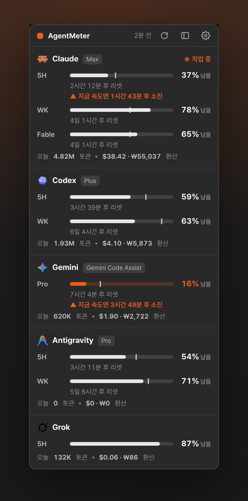
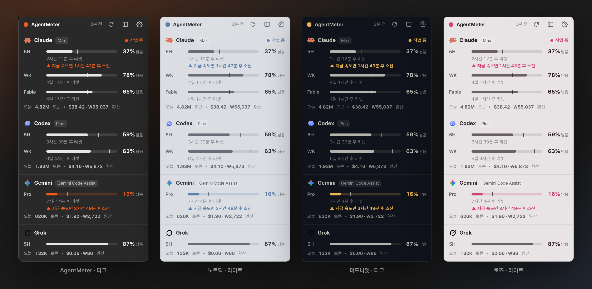
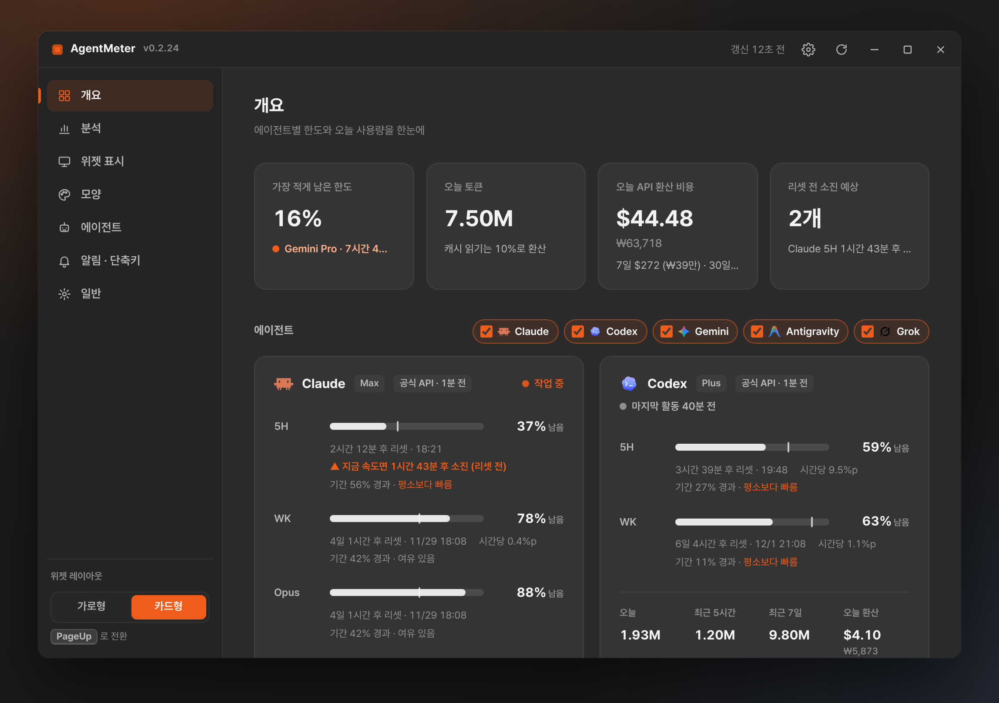
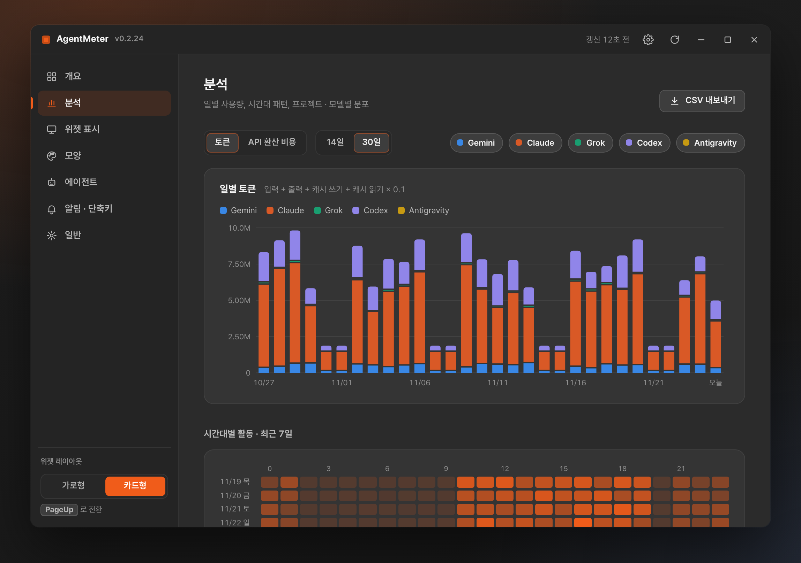
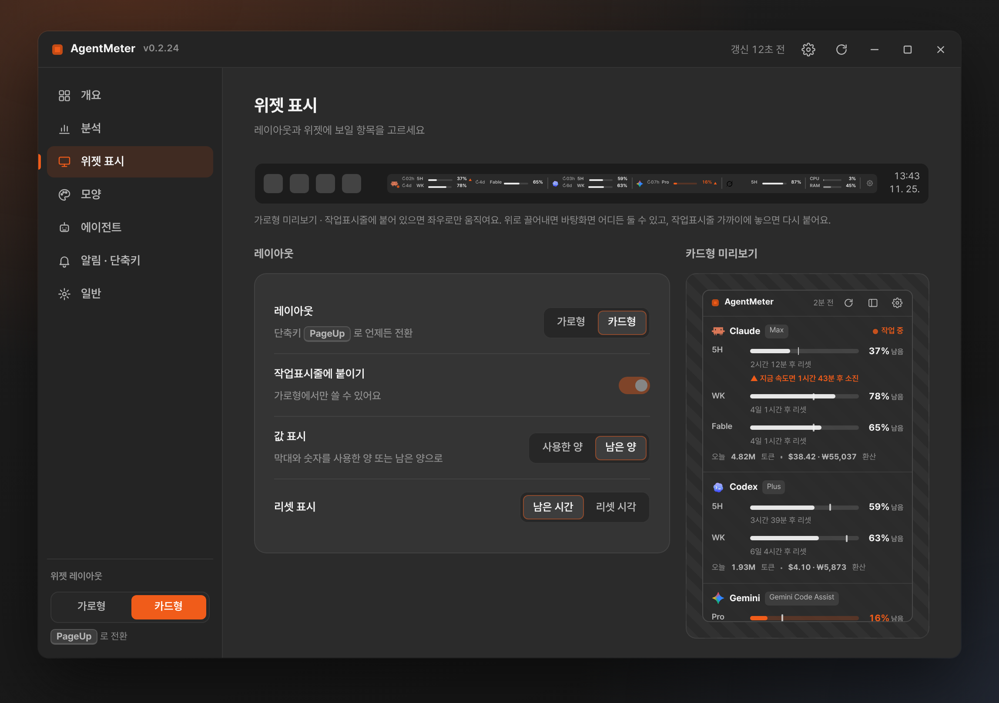
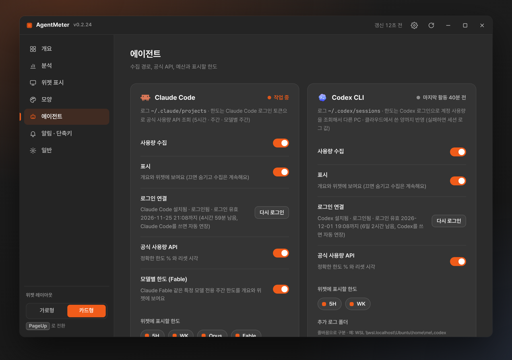
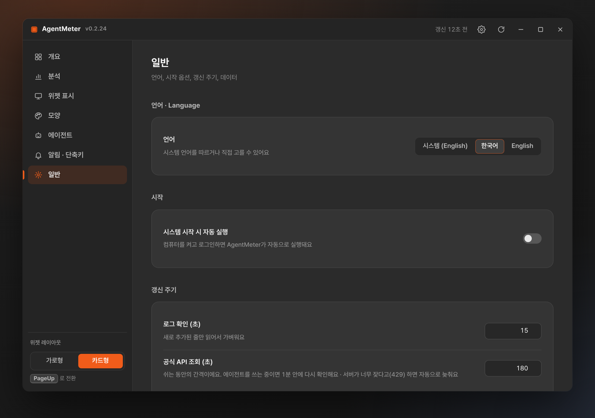

<div align="center">



# AgentMeter

**Claude Code · Codex · Gemini CLI · Antigravity · Grok** 의 한도와 사용량을<br>
작업표시줄과 바탕화면에서 바로 보는 데스크톱 위젯

[](https://github.com/cheapbutsimilar/Agent-Meter/releases/latest)


[English](README.md) | **한국어** | [日本語](README.ja.md) | [简体中文](README.zh-CN.md)

[**다운로드**](https://github.com/cheapbutsimilar/Agent-Meter/releases/latest) &nbsp;·&nbsp;
[기능](#기능) &nbsp;·&nbsp;
[위젯](#위젯) &nbsp;·&nbsp;
[대시보드](#대시보드) &nbsp;·&nbsp;
[작동 방식](#사용량을-읽는-방법) &nbsp;·&nbsp;
[FAQ](#자주-묻는-질문) &nbsp;·&nbsp;
[개발](#개발)

</div>

여러 AI 코딩 에이전트를 같이 쓰면 **어느 한도가 먼저 바닥날지**, **리셋까지 버틸 수 있을지** 알기 어렵습니다.
AgentMeter는 각 서비스의 공식 한도 %와 내 컴퓨터의 로그를 모아, 작업표시줄 한 줄이나 작은 카드 하나로 보여줍니다.
지금 속도면 언제 바닥나는지 계산해서 정말 급할 때만 알려주고, 같은 양을 API로 썼다면 얼마였을지도 원화로 보여줍니다.

> 이 오픈소스 프로젝트는 오차범위 제로, 정 확 한 입니다.

## 기능

| | |
| --- | --- |
| **공식 한도 %** | Claude 5시간 · 주간 · 모델별 한도(예: Fable), Codex 5시간 · 주간(계정 전체), Gemini CLI 일일 할당량, Antigravity CLI 5시간 · 주간 한도(Windows)를 각 서비스에서 그대로 가져옵니다. Gemini CLI와 Antigravity는 별도 에이전트라 둘 다 쓰면 나란히 볼 수 있습니다. 에이전트를 쓰는 중이면 1분 안에 다시 확인합니다. |
| **소진 예측** | 최근 사용 속도로 한도가 바닥나는 시각을 계산합니다. 리셋 전에 바닥날 것 같으면 `▲ 지금 속도면 40분 후 소진` 으로 표시합니다. |
| **페이스 눈금** | 막대 위 눈금이 한도 기간이 얼마나 지났는지 보여줍니다. 막대가 눈금보다 앞서 있으면 평소보다 빠른 것입니다. |
| **API 환산 비용** | 모델별 공개 API 가격으로 오늘 · 7일 · 30일 비용을 추정합니다. 달러, 원(₩), 둘 다 중에서 고를 수 있고 환율은 자동으로 갱신합니다. |
| **분석** | 일별 토큰 · 비용 차트(14 · 30일), 시간대별 활동 히트맵, 프로젝트별 · 모델별 사용량, CSV 내보내기. |
| **조용한 알림** | 임계값(기본 80% · 95%), 한도 리셋, 1시간 안에 바닥나는 경우만 알립니다. 같은 일은 한 주기에 한 번만 알리고 재시작해도 반복하지 않습니다. |
| **원클릭 연결** | CLI가 없거나 로그인이 안 돼 있으면 버튼 하나로 터미널을 열어 설치와 로그인까지 진행하고, 끝나면 자동으로 감지합니다. |
| **업데이트 알림** | 새 버전이 나오면 이번 업데이트 내용과 함께 지금 설치할지 물어봅니다. 지난 패치노트는 설정에서 언제든 볼 수 있습니다. |

## 위젯

하나의 위젯을 두 가지 모양으로 쓸 수 있습니다. `PageUp` 으로 언제든 바꿉니다.

- **카드형 (기본)**: 에이전트마다 한도 막대, 남은 양, 리셋까지 남은 시간, 소진 예측, 오늘 토큰과 비용을 보여주는 떠 있는 카드입니다. 화면 어디에나, **어느 모니터에나** 둘 수 있습니다.
- **가로형**: `↻02h 5H ▬▬▬ 37%` 처럼 에이전트당 한 줄(최대 두 줄)로 줄인 모양입니다. **작업표시줄에 붙이면** 시계 왼쪽에 자리 잡고, 위로 끌어내면 떨어지고, 작업표시줄 가까이 놓으면 다시 붙습니다.

| 하고 싶은 것 | 방법 |
| --- | --- |
| 가로형 ↔ 카드형 | `PageUp` 또는 우클릭 메뉴 |
| 위젯 숨기기 / 보이기 | `Shift+PageUp` |
| 대시보드 열기 | 위젯 더블클릭, 트레이 아이콘 클릭 |
| 위젯 설정 | 위젯의 ⚙ 버튼 |
| 위치 고정 · 항상 위 · 남은 양 표시 | 우클릭 메뉴 |

전체 화면 앱(영상 · 게임)이 앞에 있으면 위젯은 그 뒤로 빠집니다.



<p align="center"></p>

### 모양

대시보드 → **모양**에서 테마를 바꿀 수 있습니다. 모든 값은 정해진 범위 안에서만 바뀌어서 화면이 깨지지 않습니다.



- **모드**: 시스템 · 라이트 · 다크 (시스템이면 Windows 설정을 따라감)
- **테마**: AgentMeter, 미드나잇, 노르딕, 포레스트, 그래파이트, 로즈 (각각 라이트 · 다크)
- **색**: 강조색 · 배경색 · 글자색을 직접 지정 (글자 대비가 4.5:1보다 낮으면 경고)
- **크기**: 글꼴, 대시보드 배율 90–125%, 위젯 불투명도 · 크기 · 막대 길이 · 카드 폭 · 모서리
- **언어**: 한국어 · English. 기본은 시스템 언어를 따르고, 대시보드 → 일반 → 언어에서 바꿀 수 있습니다

## 대시보드



<table>
<tr>
<td width="50%"><p align="center"><b>분석</b> · 일별 차트, 시간대 히트맵, 프로젝트 · 모델별 사용량</p></td>
<td width="50%"><p align="center"><b>위젯 표시</b> · 미리보기를 보며 항목 켜고 끄기</p></td>
</tr>
<tr>
<td><p align="center"><b>모양</b> · 테마, 색, 글꼴, 크기</p></td>
<td><p align="center"><b>에이전트</b> · 로그인 연결, 공식 API, 표시할 한도</p></td>
</tr>
<tr>
<td><p align="center"><b>알림 · 단축키</b> · 임계값, 리셋 · 소진 임박 알림</p></td>
<td><p align="center"><b>일반</b> · 자동 실행, 업데이트, 통화 · 환율</p></td>
</tr>
</table>

## 설치

1. [**최신 릴리스**](https://github.com/cheapbutsimilar/Agent-Meter/releases/latest)에서 `AgentMeter_<버전>_x64-setup.exe` 를 내려받아 실행합니다.
2. "Windows의 PC 보호" 창이 뜨면 **추가 정보 → 실행**을 누릅니다. 코드 서명 인증서가 없는 개인 프로젝트라서 뜨는 경고입니다. 업데이트 파일은 별도의 서명으로 검증합니다.
3. 관리자 권한 없이 내 계정에만 설치됩니다. 처음 실행하면 대시보드가 열리고, 화면 오른쪽 아래에 위젯이, 트레이에 게이지 아이콘이 생깁니다.
4. Claude Code · Codex · Gemini CLI · Antigravity CLI 에 한 번이라도 로그인돼 있으면 바로 한도가 보입니다. 아니라면 대시보드 개요나 에이전트 페이지의 **원클릭 연결**을 누르세요. CLI가 없으면 설치하고 로그인 화면까지 열어 줍니다.

새 버전이 나오면 알림과 함께 **이번 업데이트 내용과 "지금 업데이트 / 나중에"** 를 묻는 창이 뜹니다. 시작 20초 뒤와 3시간마다 확인합니다.
대시보드 → 일반 → 업데이트에서 지금 확인하거나, **패치노트**를 보거나, 묻지 않고 바로 설치하도록 바꿀 수 있습니다. 전체 변경 내역은 [CHANGELOG.md](CHANGELOG.md)에 있습니다.

> Windows 10 · 11 (x64) 기준입니다. 필요한 WebView2 런타임은 Windows에 기본으로 들어 있습니다.
> macOS · Linux 는 [소스에서 빌드](#소스에서-빌드)할 수 있지만 작업표시줄 붙이기는 Windows에 맞춰 만들었습니다.

## 사용량을 읽는 방법

AgentMeter는 서버가 없습니다. 모든 데이터는 **내 컴퓨터의 로그 파일**과 **각 CLI가 이미 저장해 둔 로그인 정보**에서 읽습니다.

| 에이전트 | 토큰 · 비용 (로컬 로그) | 한도 % (공식 API) | 로그인 정보 |
| --- | --- | --- | --- |
| **Claude Code** | `~/.claude/projects/**/*.jsonl` | `api.anthropic.com/api/oauth/usage` 5시간 · 주간 · 모델별(Fable 등), 요금제는 `/api/oauth/profile` | `~/.claude/.credentials.json` · macOS 키체인 |
| **Codex CLI** | `~/.codex/sessions/**/rollout-*.jsonl` | `chatgpt.com/backend-api/wham/usage` 계정 전체 5시간 · 주간 (다른 PC · 클라우드 사용 포함) | `~/.codex/auth.json` |
| **Gemini CLI** | `~/.gemini/tmp/*/chats/session-*.jsonl` | Code Assist `retrieveUserQuota` 모델별 일일 할당량 | `~/.gemini/oauth_creds.json` |
| **Antigravity CLI** (Windows) | 없음 (토큰 로그 없음) | 공식 `agy.exe` 상태 표시줄의 5시간 · 주간 한도를 백그라운드에서 조회 ([자세히](docs/antigravity-native.md)) | 공식 CLI가 직접 처리, AgentMeter는 읽지 않음 |
| **Grok** | `~/.grok/**/*.jsonl` | 공식 API 없음 → 토큰 예산으로 추정 또는 [사용자 명령어](#사용자-명령어) | |

- 로그는 **새로 추가된 줄만** 읽고, 재개한 세션이 복사한 기록과 중복 이벤트는 걸러냅니다.
- 토큰 수는 캐시 읽기를 10%로 환산한 값입니다 (입력 + 출력 + 캐시 쓰기 + 캐시 읽기 × 0.1).
- 프로젝트는 로그에 남은 작업 폴더 이름으로 묶습니다.
- `CLAUDE_CONFIG_DIR`, `CODEX_HOME` 을 따르고, WSL에서 쓴다면 대시보드 → 에이전트 → **추가 로그 폴더**에 `\\wsl.localhost\Ubuntu\home\<me>\.claude` 처럼 넣으면 됩니다.
- **Antigravity CLI**는 Gemini CLI와 별개인 독립 에이전트입니다. `agy.exe`는 직접 찾습니다 (`where agy`, 그다음 `%LOCALAPPDATA%\agy\bin` 같은 기본 설치 폴더).
  설치돼 있지 않으면 대시보드 → 에이전트 → Antigravity CLI의 **원클릭 연결**이 공식 설치 프로그램을 실행하고 첫 실행 로그인까지 열어 줍니다. 다른 곳에 있다면 **찾아보기…**로 고르면 됩니다.
  Google LLC 서명이 유효한 `agy.exe`만 실행하고, 격리된 임시 프로필에서 모든 도구를 막은 채 프롬프트 없이 띄워 한도 숫자와 요금제만 남깁니다.
  최소 3분 간격으로 조회하고 15분이 지난 값은 숨깁니다. Antigravity는 토큰 로그를 남기지 않아서 한도만 보이고 토큰 · 비용은 없습니다.
  자세한 내용은 [docs/antigravity-native.md](docs/antigravity-native.md)를 보세요.
- 사용량 API는 공개 문서가 없는 내부 API라서 바뀔 수 있습니다. 실패해도 로그 기반 집계는 계속 동작하고, 요청이 많다는 응답(429)을 받으면 간격을 늘립니다.

### 개인정보

- **텔레메트리와 분석 도구가 없습니다.** 사용 기록은 내 컴퓨터 밖으로 나가지 않습니다.
- 로그인 토큰은 위 공식 엔드포인트에만 씁니다. Claude Code 토큰이 만료되면 Claude Code와 같은 방식으로 갱신해 원래 파일(`~/.claude/.credentials.json`)에 다시 저장합니다. Claude 앱 안의 Claude Code 세션은 이 파일을 갱신하지 않기 때문입니다. 다른 CLI의 토큰은 읽기만 합니다. Antigravity는 공식 CLI가 로그인을 직접 처리하고, AgentMeter는 그 로그인 정보를 읽지 않습니다.
- 네트워크 요청은 위 표의 공식 엔드포인트, Claude 로그인 갱신(`platform.claude.com`), 환율(`open.er-api.com`), 업데이트 확인(GitHub 릴리스)뿐입니다.

### 사용자 명령어

에이전트 설정에 명령어를 지정하면 그 출력이 한도 게이지를 대신합니다. 공식 한도를 아는 다른 도구가 있을 때 씁니다.

```json
{ "plan": "SuperGrok", "windows": [ { "label": "5H", "usedPercent": 42, "resetsAt": "2026-11-17T12:00:00Z" } ] }
```

## 자주 묻는 질문

<details>
<summary><b>비용이 실제 청구 금액과 달라요</b></summary>

AgentMeter의 비용은 **같은 양을 API로 썼다면 냈을 금액**의 추정치입니다. 구독 요금(Pro · Max 등)이나 실제 청구 금액과는 다릅니다.
구독이 API 대비 얼마나 이득인지 가늠하는 용도로 보세요. 가격표에 없는 모델은 비용에서 빠집니다.
</details>

<details>
<summary><b>다른 PC에서 쓴 것도 포함되나요?</b></summary>

**한도 %** 는 계정 기준이라 포함됩니다(Claude · Codex · Gemini 공식 API). **토큰과 비용**은 이 PC의 로그만 집계합니다.
</details>

<details>
<summary><b>요금제를 바꿨는데 이전 요금제로 보여요</b></summary>

요금제는 계정 정보에서 30분마다 다시 읽습니다. 조금 기다리거나, 해당 CLI에서 다시 로그인하면 바로 바뀝니다.
</details>

<details>
<summary><b>Fable(모델별 한도)이 보이지 않아요</b></summary>

Fable은 Claude의 특정 모델 전용 주간 한도로, Claude 사용량 API가 보내줄 때만 표시됩니다. 대시보드 → 에이전트 → Claude 의 **모델별 한도 (Fable)** 스위치가 켜져 있는지 확인하세요.
</details>

<details>
<summary><b>위젯이 사라졌어요</b></summary>

`Shift+PageUp` 을 누르거나 트레이 아이콘 메뉴에서 위젯을 다시 켜세요. 위치가 이상하면 대시보드 → 위젯 표시 → **위치 초기화**를 누르세요.
</details>

<details>
<summary><b>다른 앱에서 PageUp 키가 안 먹어요</b></summary>

전역 단축키라서 켜 두면 다른 앱이 그 키를 받지 못합니다. 대시보드 → 알림 · 단축키에서 `Ctrl+PageUp` 같은 조합키로 바꾸거나 끄세요.
</details>

<details>
<summary><b>알림이 너무 많아요 / 아예 끄고 싶어요</b></summary>

대시보드 → 알림 · 단축키에서 알림 종류별로 끄거나, 전체 알림 스위치로 모두 끌 수 있습니다.
소진 임박 알림은 1시간 안에 바닥나고 리셋까지 30분 넘게 남을 때만, 한 주기에 한 번 뜹니다.
</details>

## 개발

Rust + [Tauri 2](https://tauri.app) 앱이고, UI는 빌드 단계 없는 HTML · CSS · JS 입니다.

| 하고 싶은 것 | Windows | 명령 |
| --- | --- | --- |
| **브라우저 미리보기** — 앱 빌드 없이 데모 데이터로 위젯과 대시보드를 한 화면에 | `preview.bat` | `cargo run -p agentmeter-devserver` |
| **실제 앱 개발 모드** — 내 진짜 사용량으로 실행 | `dev.bat` | `cargo tauri dev` |
| **배포용 빌드** — `agentmeter.exe` + 설치 파일 | `build.bat` | `cargo tauri build` |
| 테스트 | | `cargo test --workspace` |
| README 이미지 다시 만들기 ([Playwright](https://playwright.dev), Pretendard 글꼴 권장) | | `npm run screenshots` |

브라우저 미리보기(`http://localhost:1420`)는 `ui/` 파일을 저장하면 바로 반영되고, 위쪽 버튼으로 사용률 · 표시 방식을 바꿔 볼 수 있습니다.
실제 앱 개발 모드는 Rust 코드를 저장하면 다시 빌드하고 재시작합니다.

### 소스에서 빌드

[Git](https://git-scm.com)과 [Rust](https://rustup.rs)(stable)가 필요합니다. Linux는 `libwebkit2gtk-4.1-dev libayatana-appindicator3-dev librsvg2-dev libxdo-dev` 도 필요합니다.

```bash
git clone -b main https://github.com/cheapbutsimilar/Agent-Meter
```

```bash
cd Agent-Meter && cargo run --release -p agentmeter
```

설치 파일까지 만들려면 `cargo install tauri-cli --version "^2" --locked` 후 저장소 폴더에서 `cargo tauri build` 를 실행하세요.

<details>
<summary><b>폴더 구조</b></summary>

```
crates/core/       수집 로직 (OS 의존 없음, 단위 테스트)
crates/antigravity/  Windows용 Antigravity 한도 수집 (ConPTY, 서명 확인, 격리된 프로필)
  usage/           Claude · Codex · Gemini · Antigravity · Grok 수집기, 예측, 사용량 장부
  pricing.rs       모델별 API 가격      settings.rs  설정 스키마 · 검증 · 마이그레이션
src-tauri/         창 배치 · 멀티 모니터 · 작업표시줄 고정 · 단축키 · 트레이 게이지 · 알림 · 자동 업데이트
ui/widget/         위젯 창
ui/dashboard/      대시보드
ui/shared/         tokens.css(디자인 토큰), theme.js(테마 엔진), render.js(위젯 렌더러), util.js, logos.js
crates/devserver/  브라우저 미리보기 서버
scripts/           mock-api.js(데모 데이터), preview.js(README 이미지), make-icons.py(아이콘)
docs/screenshots/  README 이미지. demo-gif.js(데모 GIF) · strip-duo.js: 실제 위젯 UI를 렌더링 (화면 녹화가 아닌 재현)
```

같은 디자인과 구조로 다른 앱을 만들 때는 [docs/HANDOFF.md](docs/HANDOFF.md)를 참고하세요.
</details>

릴리스 절차와 자동 업데이트 서명 키 설정은 [docs/RELEASING.md](docs/RELEASING.md)에 있습니다.

## 로드맵

- macOS 메뉴 막대 지원 (예정)

## 고지

- **비용은 추정치입니다.** 공개 API 가격표로 계산하며 실제 구독 요금이나 청구 금액과 다릅니다.
- Claude, Codex(OpenAI), Gemini · Antigravity(Google), Grok(xAI)의 이름과 로고는 각 회사의 상표입니다. 이 프로젝트는 어느 회사와도 관련 없는 비공식 도구입니다.
  로고 SVG는 [@lobehub/icons](https://github.com/lobehub/lobe-icons)(MIT)에서 가져왔습니다.
- 디자인: 베이스 `#2B2B2B`, 키 컬러 `#F05C1A`. 막대는 평소 밝은 회색이고, 첫 번째 임계값부터 주황, 두 번째부터 빨강으로 바뀌어 색만으로 상태를 구분하지 않도록 아이콘을 함께 씁니다.

<div align="center"><sub><a href="LICENSE">MIT License</a></sub></div>
