<div align="center">

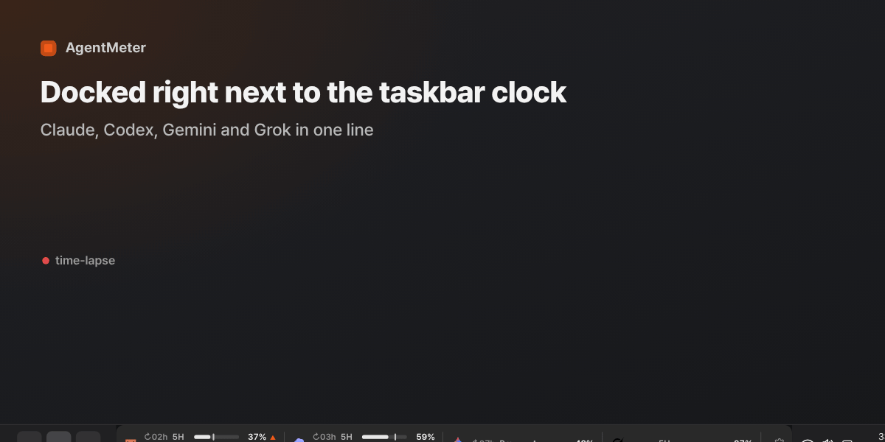

# AgentMeter

在 Windows 任务栏、Mac 菜单栏或桌面上直接查看<br>
**Claude Code · Codex · Gemini CLI · Antigravity · Grok** 的使用额度和用量的桌面小组件

[](https://github.com/cheapbutsimilar/Agent-Meter/releases/latest)


[](LICENSE)

[English](README.md) | [한국어](README.ko.md) | [日本語](README.ja.md) | **简体中文**

[**下载**](https://github.com/cheapbutsimilar/Agent-Meter/releases/latest) &nbsp;·&nbsp;
[功能](#功能) &nbsp;·&nbsp;
[小组件](#小组件) &nbsp;·&nbsp;
[仪表板](#仪表板) &nbsp;·&nbsp;
[安装](#安装) &nbsp;·&nbsp;
[工作原理](#工作原理) &nbsp;·&nbsp;
[隐私](#隐私) &nbsp;·&nbsp;
[常见问题](#常见问题) &nbsp;·&nbsp;
[开发](#开发)

</div>

> **关于语言：** 目前应用界面支持英文和韩文，中文界面将在后续版本中加入。

同时使用多个 AI 编程代理时，很难判断**哪个额度会先用完**，以及**能否撑到重置**。
AgentMeter 读取各服务官方提供的额度百分比和你本机上的使用日志，以任务栏中的一行或桌面上的一张小卡片呈现。
它会按当前速度推算额度何时耗尽，只在真正紧急时提醒你，还会显示同样的用量按 API 价格计算需要多少钱。

- **100% 本地，零遥测。** 没有服务器、没有账号、没有数据分析。你的使用数据不会离开你的电脑。
- **可验证的源码构建。** 每个版本都由公开的 GitHub Actions 工作流从本仓库构建，你也可以[自己构建](#从源码构建)。
- **小巧轻量。** 基于 Rust + Tauri 的 2.3 MB 安装包，只读取新增的日志行。

## 功能

| | |
| --- | --- |
| **官方额度 %** | 直接从各服务获取 Claude 的 5 小时、每周及按模型的额度（如 Claude Fable），Codex 的 5 小时和每周额度（整个账号），Gemini CLI 的每日配额，以及 Antigravity CLI 的 5 小时和每周额度（Windows）。Gemini CLI 与 Antigravity 是两个独立的代理，可以并排查看。代理工作期间，会在一分钟内重新检查额度。 |
| **耗尽预测** | 根据最近的使用速度推算额度耗尽的时间，若会在重置前用完，则显示 `▲ runs out in 40m at this pace`。 |
| **进度刻度** | 每条进度条上的刻度表示额度周期已经过去了多少。如果进度条超过刻度，说明你比平时用得更快。 |
| **API 等价成本** | 按公开 API 价格估算今天、7 天和 30 天的成本，例如 `$44.48 today · 7d $272 · 30d $1,016`。默认以美元显示，也可选择韩元（₩）或同时显示。 |
| **分析** | 每日 token 和成本图表（14 天或 30 天）、按小时的活动热力图、按项目和模型的用量，以及 CSV 导出。 |
| **安静的提醒** | 只在达到阈值（默认 80% 和 95%）、额度重置，以及额度将在一小时内耗尽时提醒。每条提醒在每个周期只触发一次，即使重启也不会重复。 |
| **一键连接** | 缺少 CLI 或未登录？点一下按钮即可打开终端，安装 CLI 并完成登录，完成后 AgentMeter 会自动识别。 |
| **更新提示** | 有新版本时会显示更新内容，可选择*立即更新*或*稍后*。以往的更新说明也可以在设置中随时查看。 |
| **英文和韩文** | 跟随系统语言，可随时在设置 → General → Language 中切换。中文界面将在后续加入。 |

## 小组件

一个小组件，两种布局，按 `PageUp` 切换。

- **卡片（默认）**：浮动卡片，显示每个代理的额度进度条、剩余量、距离重置的时间、耗尽预测，以及今天的 token 和成本。可以放在任意显示器的任意位置。
- **条形**：每个代理一行，如 `↻02h 5H ▬▬▬ 37%`。可以**停靠在任务栏**时钟旁边，向上拖出即可浮在桌面上，拖回任务栏附近又会重新停靠。

| 操作 | 方法 |
| --- | --- |
| 切换条形 ↔ 卡片 | `PageUp`，或右键菜单 |
| 隐藏 / 显示小组件 | `Shift+PageUp` |
| 打开仪表板 | 双击小组件，或点击托盘图标（Mac：菜单栏图标 → Open dashboard） |
| 小组件设置 | 小组件上的 ⚙ 按钮 |
| 锁定位置 · 置顶 · 显示剩余量 | 右键菜单 |

在播放视频、玩游戏等全屏应用时，小组件会自动退到后面。

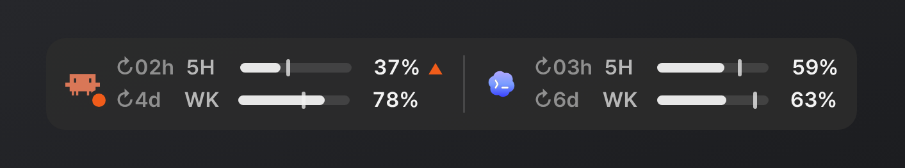

<p align="center">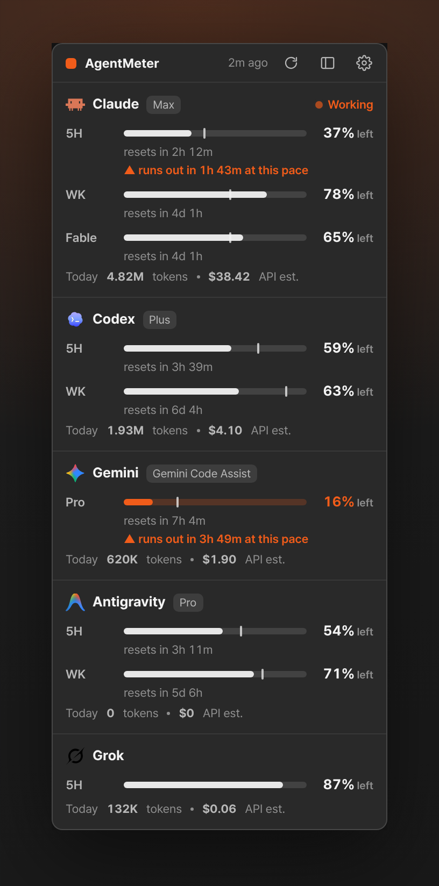</p>

### 外观

在仪表板 → **Appearance** 中选择主题。所有数值都限制在安全范围内，不会破坏布局。

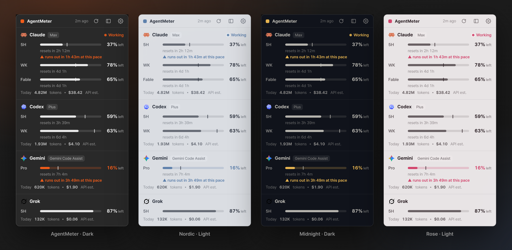

- **模式**：跟随系统、浅色或深色（跟随系统即跟随 Windows 或 macOS 设置）
- **主题**：AgentMeter、Midnight、Nordic、Forest、Graphite 和 Rose，每个都有浅色和深色
- **颜色**：自定义强调色、背景色和文字颜色，文字对比度低于 4.5:1 时会给出警告
- **尺寸**：字体、仪表板缩放（90–125%），以及小组件的不透明度、缩放、进度条长度、卡片宽度和圆角

## 仪表板

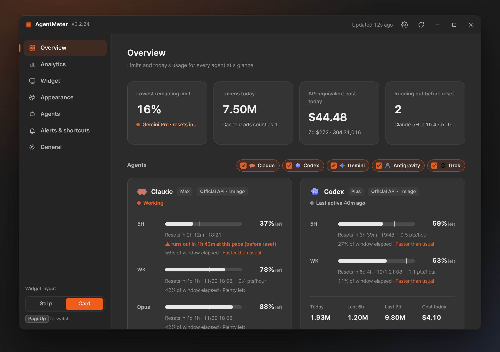

<table>
<tr>
<td width="50%">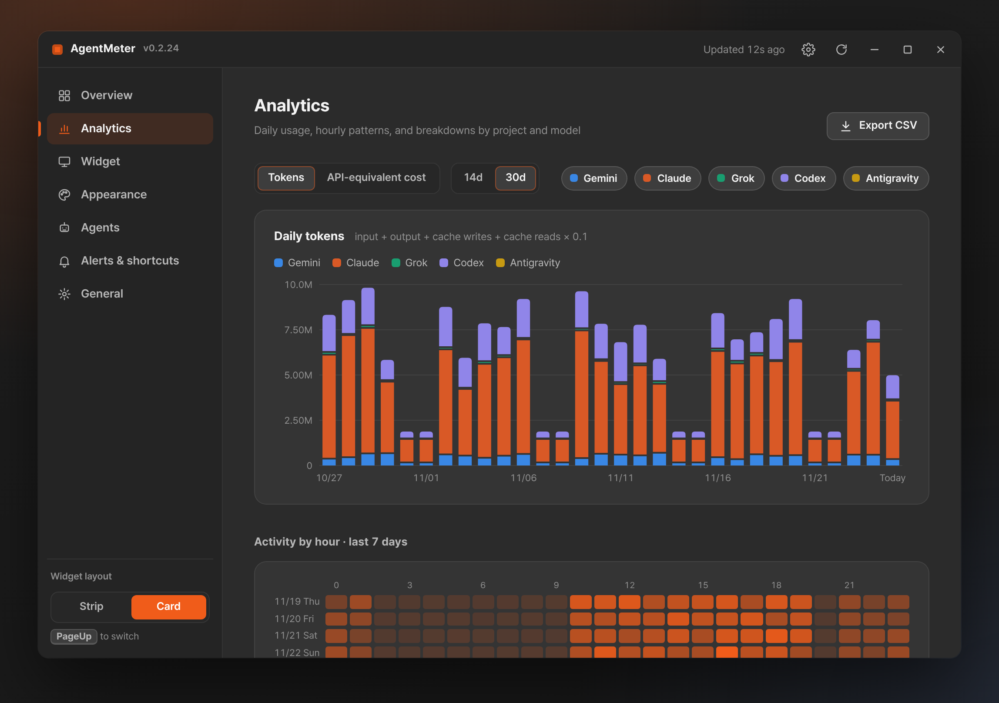<p align="center"><b>分析</b> · 每日图表、按小时热力图、按项目和模型的用量</p></td>
<td width="50%">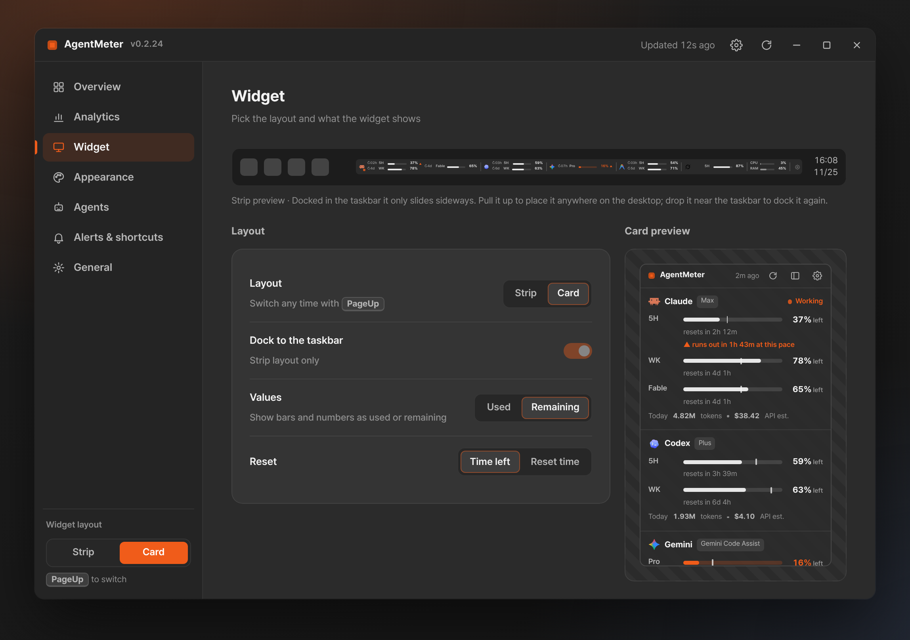<p align="center"><b>小组件</b> · 一边实时预览一边开关各项内容</p></td>
</tr>
<tr>
<td>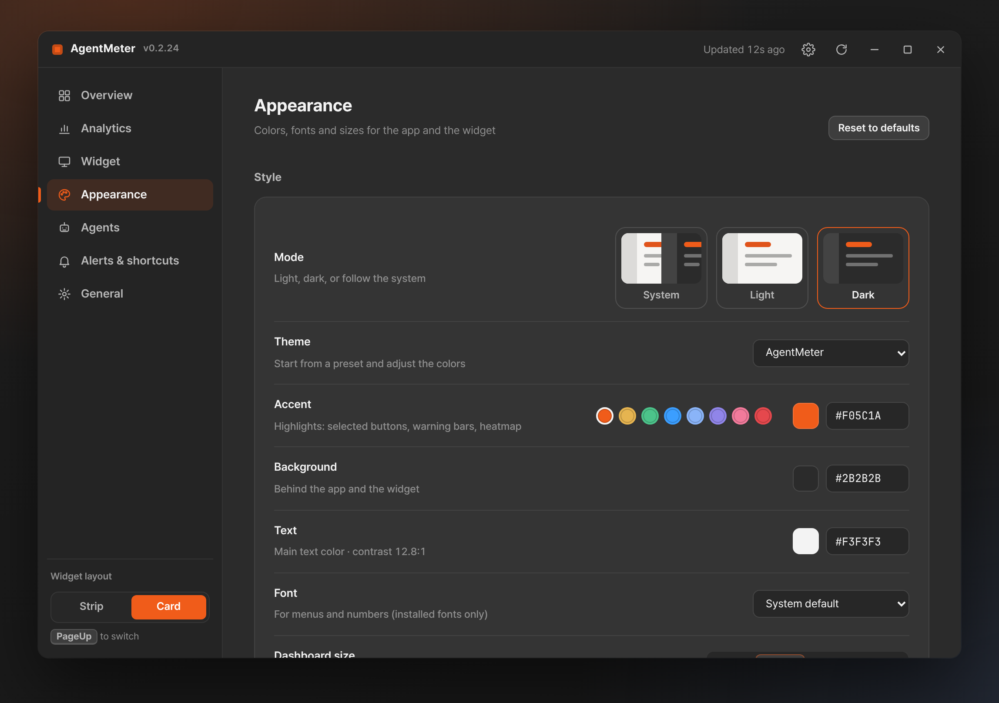<p align="center"><b>外观</b> · 主题、颜色、字体和尺寸</p></td>
<td>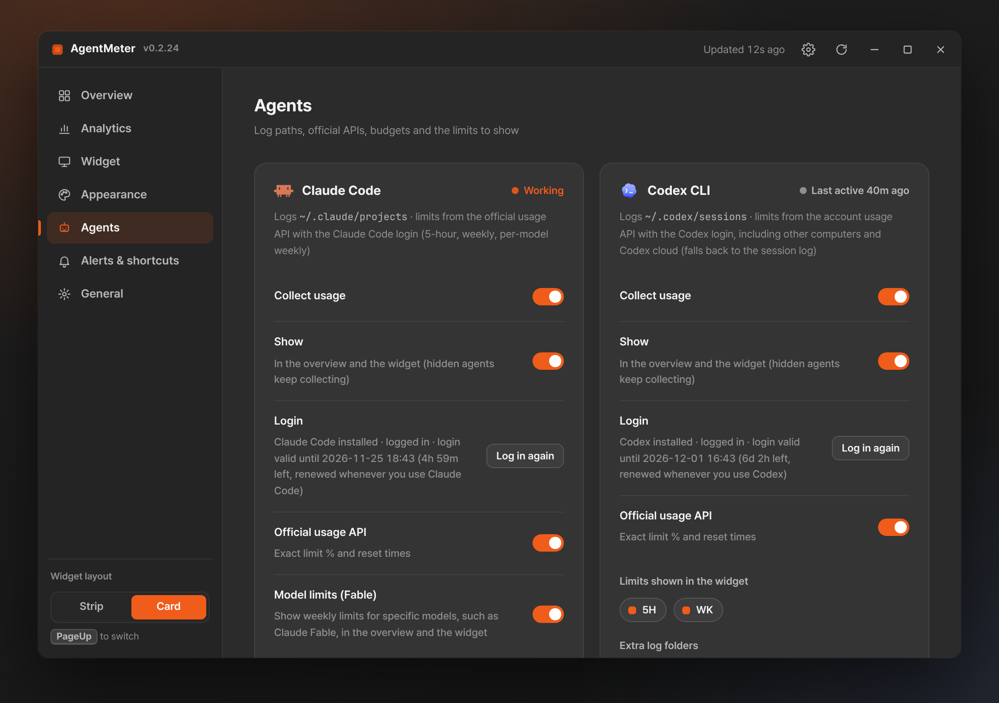<p align="center"><b>代理</b> · 登录、官方 API、要显示的额度</p></td>
</tr>
<tr>
<td>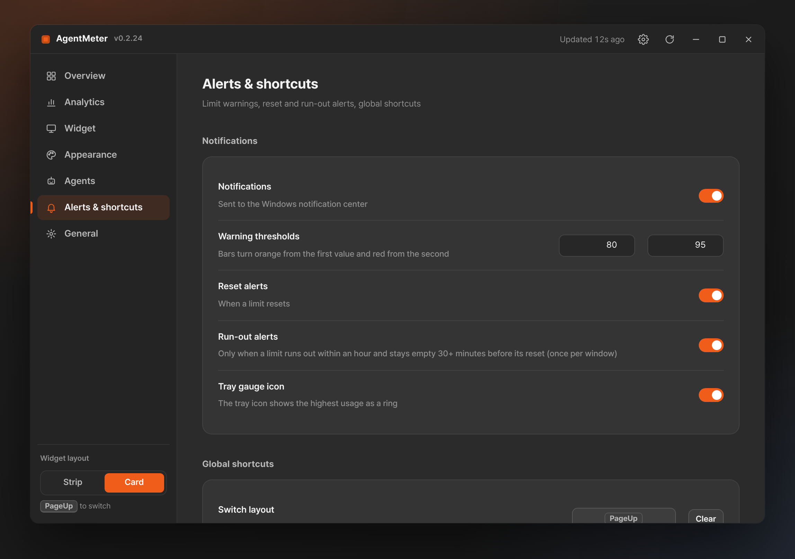<p align="center"><b>提醒和快捷键</b> · 阈值、重置和耗尽提醒</p></td>
<td>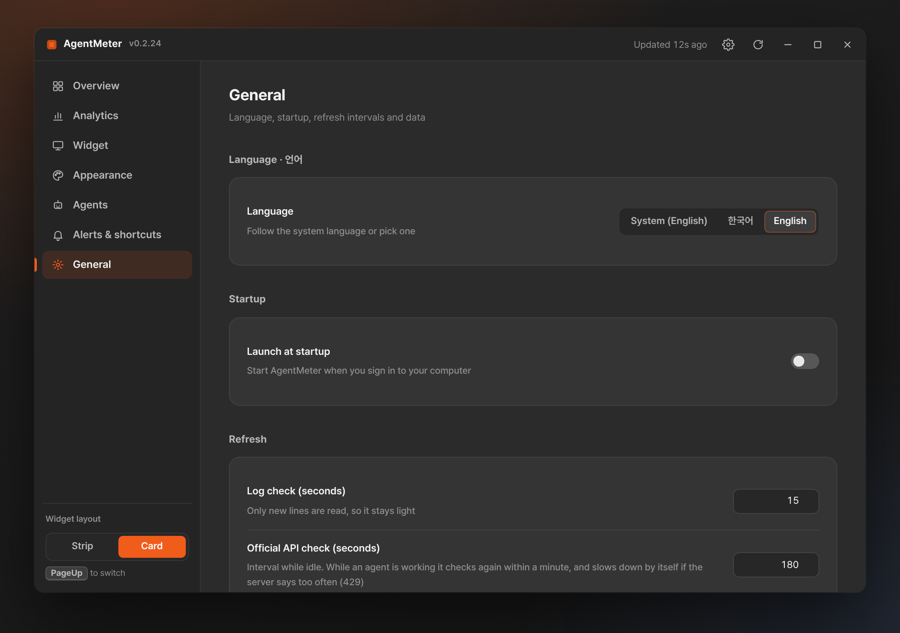<p align="center"><b>通用</b> · 语言、开机启动、更新、货币</p></td>
</tr>
</table>

## 安装

### Windows

1. 从[**最新版本**](https://github.com/cheapbutsimilar/Agent-Meter/releases/latest)下载 `AgentMeter_<version>_x64-setup.exe` 并运行。
2. 如果 Windows 显示 **“Windows 已保护你的电脑”**，请点击**更多信息 → 仍要运行**。由于这是个人开源项目，安装包没有代码签名。每个版本都由本仓库的[公开工作流](.github/workflows/release.yml)构建，更新在安装前会用签名密钥进行校验。
3. 仅为当前用户安装，不需要管理员权限。首次运行时会打开仪表板，小组件出现在右下角，托盘中会出现一个仪表图标。
4. 如果你之前登录过 Claude Code、Codex、Gemini CLI 或 Antigravity CLI，额度会立即显示。否则请在仪表板概览或代理页面点击 **Connect**，它会在缺少 CLI 时自动安装，并打开登录。

### macOS

1. 从[**最新版本**](https://github.com/cheapbutsimilar/Agent-Meter/releases/latest)下载 `AgentMeter_<version>_universal.dmg`。同一个文件可在 Apple Silicon 和 Intel Mac 上原生运行（macOS 11 Big Sur 及以上）。
2. 打开 `.dmg`，将 **AgentMeter** 拖到 **应用程序** 文件夹。
3. 由于这是未经 Apple 公证（notarization）的个人开源项目，首次打开时 **Gatekeeper** 会提示“无法打开‘AgentMeter’”/“Apple 无法验证……”并阻止运行。用以下任一方式允许一次即可：
   - 打开 **系统设置 → 隐私与安全性**，向下滚动，点击 AgentMeter 旁边的 **仍要打开** 并确认。（macOS 14 及更早版本也可以在应用程序文件夹中按住 Control 点按该应用 → **打开** → **打开**。）
   - 或在终端中运行：`xattr -dr com.apple.quarantine /Applications/AgentMeter.app`
4. AgentMeter 常驻在 **菜单栏**（没有 Dock 图标）。点击仪表图标即可打开菜单，小组件的条形和卡片两种布局都浮在桌面上。按 `PageUp` 切换（MacBook 键盘为 `fn` + `↑`），**置顶** 选项在小组件的右键菜单中。Mac 没有任务栏，因此条形布局也始终是浮动的。

在 Mac 上，Claude Code 的登录信息从 **钥匙串**（`Claude Code-credentials`）读取，系统可能会询问一次是否允许访问，请选择 **始终允许**。Antigravity CLI 的额度采集目前仅支持 Windows。

有新版本时，会弹出一个窗口显示**更新内容**，并提供*立即更新 / 稍后*。AgentMeter 会在启动 20 秒后以及每 3 小时检查一次。你也可以在仪表板 → General → Updates 中立即检查、查看更新说明，或切换为静默安装。完整历史见 [CHANGELOG.md](CHANGELOG.md)（韩文）。

> 提供 Windows 10 和 11（x64）以及 macOS 11 及以上（Apple Silicon 和 Intel）的发布版本。Windows 所需的 WebView2 运行时已随 Windows 提供。
> Linux 可以[从源码构建](#从源码构建)，任务栏停靠仅适用于 Windows。

## 工作原理

AgentMeter 没有服务器。所有数据都读取自**你本机上的日志文件**以及**各 CLI 已经保存的登录信息**。

| 代理 | Token 和成本（本地日志） | 额度 %（官方 API） | 登录 |
| --- | --- | --- | --- |
| **Claude Code** | `~/.claude/projects/**/*.jsonl` | `api.anthropic.com/api/oauth/usage`：5 小时、每周及按模型的额度（如 Fable）；套餐来自 `/api/oauth/profile` | `~/.claude/.credentials.json` · macOS 钥匙串 |
| **Codex CLI** | `~/.codex/sessions/**/rollout-*.jsonl` | `chatgpt.com/backend-api/wham/usage`：整个账号的 5 小时和每周额度，包括其他电脑和 Codex cloud | `~/.codex/auth.json` |
| **Gemini CLI** | `~/.gemini/tmp/*/chats/session-*.jsonl` | Code Assist `retrieveUserQuota`：按模型的每日配额 | `~/.gemini/oauth_creds.json` |
| **Antigravity CLI**（Windows） | 无（没有 token 日志） | 在后台读取官方 `agy.exe` 状态栏中的 5 小时和每周额度（[详情](docs/antigravity-native.md)） | 由官方 CLI 管理，AgentMeter 不会读取 |
| **Grok** | `~/.grok/**/*.jsonl` | 没有官方 API：根据 token 预算估算，或使用[自定义命令](#自定义命令) | |

- 只读取**新增的行**。恢复的会话（会复制之前的消息）和重复事件都会被过滤。
- Token 数按缓存读取计 10% 统计（输入 + 输出 + 缓存写入 + 缓存读取 × 0.1）。
- 项目按日志中记录的工作目录分组。
- 支持 `CLAUDE_CONFIG_DIR` 和 `CODEX_HOME`。对于在 WSL 中运行的代理，请在仪表板 → Agents → **Extra log folders** 中添加类似 `\\wsl.localhost\Ubuntu\home\<me>\.claude` 的路径。
- **Antigravity CLI** 是独立于 Gemini CLI 的另一个代理。AgentMeter 会自行查找 `agy.exe`（先 `where agy`，再查找 `%LOCALAPPDATA%\agy\bin` 等默认安装目录）。如果尚未安装，仪表板 → Agents → Antigravity CLI 中的 **Connect** 会运行官方安装程序并打开首次登录。如果安装在其他位置，可用 **Browse…** 选择。AgentMeter 只运行带有有效 Google LLC 签名的 `agy.exe`，并在拒绝所有工具、不发送任何提示词的隔离临时配置中运行，只保留配额数字和套餐信息。最多每 3 分钟检查一次，超过 15 分钟的数据会被隐藏。Antigravity 不写 token 日志，因此只有额度，没有 token 数和成本。详见 [docs/antigravity-native.md](docs/antigravity-native.md)。
- 这些用量 API 是未公开的内部接口，可能会变化。即使调用失败，基于日志的统计仍会继续工作；当服务器返回 *too many requests*（429）时，AgentMeter 会自动降低频率。

### 隐私

- **没有遥测、没有数据分析、没有账号。** 你的使用记录只保存在你的电脑上。
- 登录令牌只会发送到上表中的官方接口。Antigravity 的登录由官方 CLI 自行管理，AgentMeter 不读取其凭据。Claude Code 的令牌过期时，AgentMeter 会用与 Claude Code 相同的方式续期，并写回同一个文件，因为 Claude 桌面应用中的 Claude Code 会话不会刷新该文件。其他 CLI 的令牌均为只读。
- 网络请求仅限于：表中的接口、Claude 登录续期（`platform.claude.com`）、用于韩元显示的汇率（`open.er-api.com`），以及更新检查（GitHub Releases）。

### 自定义命令

可以为任意代理指定一条命令，用其 JSON 输出驱动额度仪表。当有其他工具知道官方额度时，这会很方便。

```json
{ "plan": "SuperGrok", "windows": [ { "label": "5H", "usedPercent": 42, "resetsAt": "2026-11-17T12:00:00Z" } ] }
```

## 常见问题

<details>
<summary><b>为什么成本和我的账单不一样？</b></summary>

这里的成本是**同样的用量按公开 API 价格计算的金额**，不是你的订阅价格（Pro、Max 等），也不是实际扣费。可以用它来了解订阅相比 API 帮你省了多少。没有公开价格的模型不计入。
</details>

<details>
<summary><b>会包含我在其他电脑上的用量吗？</b></summary>

**额度百分比**会包含。它来自官方 API，覆盖整个账号（Claude、Codex、Gemini）。**Token 和成本**只统计本机的日志。
</details>

<details>
<summary><b>我换了套餐，但仍显示旧套餐。</b></summary>

套餐信息每 30 分钟从账号重新读取一次。稍等片刻，或重新登录 CLI 即可立即更新。
</details>

<details>
<summary><b>“Fable”是什么？为什么我看不到？</b></summary>

Fable 是一个 Claude 模型，除了总的每周额度外，还有自己单独的每周额度。只要 Claude 的用量 API 返回这类按模型的额度，AgentMeter 就会显示。请确认仪表板 → Agents → Claude 中的 **Model limits (Fable)** 已开启。
</details>

<details>
<summary><b>小组件不见了。</b></summary>

按 `Shift+PageUp`，或从托盘菜单重新打开小组件。如果它跑到了奇怪的位置，请使用仪表板 → Widget → **Reset position**。
</details>

<details>
<summary><b>PageUp 在其他应用中不起作用了。</b></summary>

全局快捷键会占用其他应用的按键。请在仪表板 → Alerts & shortcuts 中改为 `Ctrl+PageUp` 之类的组合键，或将其关闭。
</details>

<details>
<summary><b>通知太多了？</b></summary>

可以在仪表板 → Alerts & shortcuts 中按类型或全部关闭提醒。耗尽提醒只会在额度将在一小时内用完、且在重置前空置 30 分钟以上时触发，每个周期只提醒一次。
</details>

## 开发

这是一个 Rust + [Tauri 2](https://tauri.app) 应用。界面是无需构建步骤的原生 HTML、CSS 和 JS。

| 用途 | Windows | 命令 |
| --- | --- | --- |
| **浏览器预览**：用演示数据查看小组件和仪表板，无需构建应用 | `preview.bat` | `cargo run -p agentmeter-devserver` |
| 用你自己的用量**运行真实应用** | `dev.bat` | `cargo tauri dev` |
| **发布构建**：`agentmeter.exe` + 安装包 | `build.bat` | `cargo tauri build` |
| 测试 | | `cargo test --workspace` |
| 重新生成 README 图片（[Playwright](https://playwright.dev)；推荐 Pretendard 字体） | | `npm run screenshots` |

浏览器预览（`http://localhost:1420`）会在你保存 `ui/` 下的文件时自动刷新。在页面 URL 后加上 `?lang=en` 或 `?lang=ko` 即可选择语言。开发版应用会在 Rust 代码变化时重新构建并重启。

### 从源码构建

需要 [Git](https://git-scm.com) 和 [Rust](https://rustup.rs)（stable）。在 Linux 上还需安装 `libwebkit2gtk-4.1-dev libayatana-appindicator3-dev librsvg2-dev libxdo-dev`。

```bash
git clone -b main https://github.com/cheapbutsimilar/Agent-Meter
```

```bash
cd Agent-Meter && cargo run --release -p agentmeter
```

如需安装包，请先运行 `cargo install tauri-cli --version "^2" --locked`，然后在仓库目录中运行 `cargo tauri build`。

<details>
<summary><b>项目结构</b></summary>

```
crates/core/       采集器和逻辑（无操作系统依赖，带单元测试）
crates/antigravity/  Windows 原生 Antigravity 配额采集（ConPTY、签名校验、隔离配置）
  usage/           Claude · Codex · Gemini · Antigravity · Grok 采集器、预测、用量账本
  pricing.rs       各模型的 API 价格      settings.rs  设置结构、校验、迁移
src-tauri/         窗口、多显示器、任务栏停靠、快捷键、托盘仪表、通知、更新
ui/widget/         小组件窗口
ui/dashboard/      仪表板
ui/update/         “新版本”窗口
ui/shared/         i18n.js（韩文 / 英文）、tokens.css、theme.js、render.js（小组件渲染）、util.js、logos.js
crates/devserver/  浏览器预览服务器
scripts/           mock-api.js（演示数据）、preview.js（README 图片）、release-notes.js、make-icons.py
docs/screenshots/  README 图片；demo-gif.js（演示 GIF）和 strip-duo.js 从真实的小组件界面渲染（是复现，不是录屏）
```

如需基于相同的设计和外壳构建其他应用，请参阅 [docs/HANDOFF.md](docs/HANDOFF.md)；发布与更新签名的设置请参阅 [docs/RELEASING.md](docs/RELEASING.md)。
</details>

## 路线图

- 在 macOS 上采集 Antigravity CLI 额度（计划中）
- 日文和中文界面（计划中）

## 说明

- **成本为按公开 API 价格的估算值**，不是你的订阅价格或账单。
- Claude、Codex（OpenAI）、Gemini 和 Antigravity（Google）以及 Grok（xAI）的名称和标志均为其各自所有者的商标。AgentMeter 是独立项目，与上述任何一方均无关联。标志 SVG 来自 [@lobehub/icons](https://github.com/lobehub/lobe-icons)（MIT）。
- 设计：底色 `#2B2B2B`，主色 `#F05C1A`。进度条平时为浅灰色，达到第一个阈值后变为橙色，达到第二个阈值后变为红色。颜色旁都配有图标，因此状态判断不会只依赖颜色。

<div align="center"><sub><a href="LICENSE">MIT License</a></sub></div>
